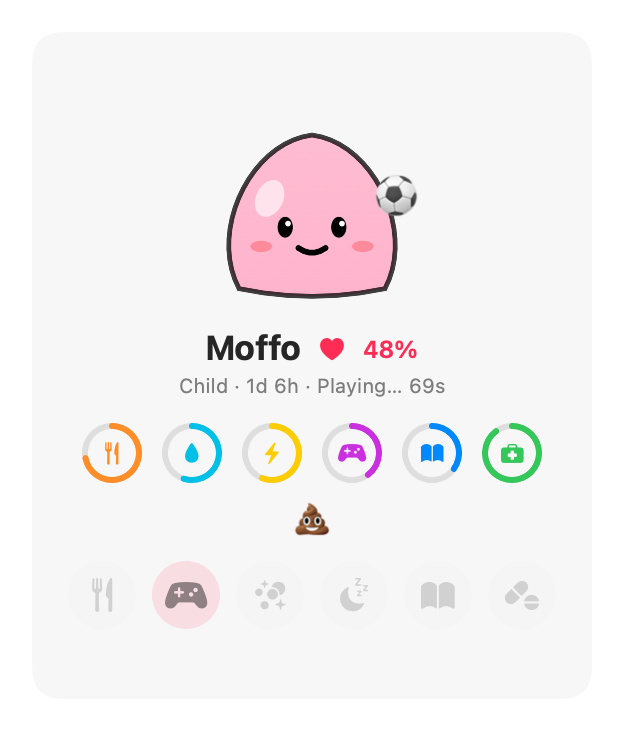

# Moffo

A tiny, squishy jelly that lives in your Mac menu bar. Think tamagotchi: feed it, play with it, give it a bath, put it to bed and let it study. Ignore it and it gets sick… and eventually dies.

Free and open source. Native SwiftUI, no dependencies. English and Italian.

<p align="center"></p>
<p align="center"></p>

## Features

- Tap the egg 10 times to hatch it, then it grows: **baby** (day 1), **child** (days 2–3), **adult**
- The adult form depends on how well you cared for it: **shiny**, classic or **grumpy**
- Stats: **Fullness, Hygiene, Energy, Fun, Smarts, Health** and an overall **Happiness** index. Click the rings for details
- Actions: Feed, Play, Bath, Sleep/Wake, Study, Medicine. Each one takes a little time and energy, and pays off when it ends. Hover a button to see the numbers
- **Study**: Moffo studies for 3 minutes, then tells you a useful or curious fact
- Poops every ~4 hours. Too many poops or an empty stat make it sick, and a sick Moffo loses health until it dies
- Ignored, it lives about 2 days. While the Mac is off or asleep time runs at ¼ speed, so a weekend away is fine
- A small graveyard keeps your past Moffos
- macOS notifications when it needs you, an optional "Open at login" checkbox
- The menu bar icon changes with its mood and shows a progress ring while it's busy

## Requirements

- macOS 14 (Sonoma) or later
- Xcode or the Xcode Command Line Tools (Swift 5.9+) to build it

## Install

```bash
git clone https://github.com/andrearufo/moffo.git
cd moffo
./scripts/build-app.sh
cp -R build/Moffo.app /Applications/
open /Applications/Moffo.app
```

The app is ad-hoc signed. If macOS blocks it, right-click it in Finder, choose Open, then confirm.

To start Moffo at login, tick "Open at login" at the bottom of its window.

## Development

```bash
swift test                                   # simulation tests
./scripts/build-app.sh && open build/Moffo.app
```

Time warp for testing: `MOFFO_SPEED=60` makes one real minute last one Moffo hour.

```bash
pkill Moffo; MOFFO_SPEED=60 build/Moffo.app/Contents/MacOS/Moffo
```

Reset Moffo (new egg, empty graveyard): `pkill Moffo; defaults delete dev.rufo.moffo`

Try another language: `defaults write dev.rufo.moffo AppleLanguages '(en)'` (remove it with `defaults delete dev.rufo.moffo AppleLanguages`). Translations live in `Resources/<lang>.lproj/Localizable.strings`.

All game rules live in [`Sources/MoffoCore/Pet.swift`](Sources/MoffoCore/Pet.swift), and the facts Moffo learns live in [`Facts.swift`](Sources/MoffoCore/Facts.swift).

## License

MIT
